

[← Voltar ao portfólio](README.md)

[🧪 Projetos fictícios](#-projetos-fictícios) · [🏢 Projetos reais](#-projetos-reais)

---

## 🧪 Projetos fictícios

> [!NOTE]
> **Estes projetos são fictícios.** Foram criados por mim para estudo e para demonstrar o meu trabalho. As marcas, os negócios e os dados mostrados não existem, e nenhum deles foi feito para um cliente.

| Projeto | Tipo | Status | Tecnologias | Links |
|---|---|:---:|---|---|
| 🍝 [**Osteria Lume**](#osteria-lume) | Lojas e cardápios | 🟢 Demonstração no ar | Next.js 16 · React 19 · TypeScript | [Ver online](https://osteria-lume.vercel.app) · [Código](https://github.com/AkiraLeco/osteria-lume) |
| 🩸 [**Glicolog**](#glicolog) | Sistemas web | ✅ Concluído | Next.js 16 · TypeScript · Tailwind CSS | [Código](https://github.com/AkiraLeco/glicolog) |
| 🃏 [**Vino Cards**](#vino-cards) | Lojas e cardápios | 🚧 Em desenvolvimento | Next.js 16 · React 19 · TypeScript | [Ver online](https://vino-cards.vercel.app) · [Código](https://github.com/AkiraLeco/vino-cards) |
| 🛍️ [**NORTE**](#norte-ecommerce) | Lojas e cardápios | ✅ Concluído | React · Vite · React Router | [Código](https://github.com/AkiraLeco/norte-ecommerce) |
| 🍽️ [**Sabor & Arte**](#sabor-e-arte) | Lojas e cardápios | ✅ Concluído | React · Vite · React Router | [Código](https://github.com/AkiraLeco/sabor-e-arte) |
| 🏋️ [**FORJA Academia**](#academia) | Sites e landing pages | ✅ Concluído | React · Vite · React Router | [Código](https://github.com/AkiraLeco/forja-academia) |
| 💈 [**Black Crown Barbershop**](#barbearia) | Sites e landing pages | ✅ Concluído | Node.js · Express · HTML | [Código](https://github.com/AkiraLeco/barbearia-black-crown) |
| 💎 [**Maison Áurea**](#loja-premium) | Lojas e cardápios | ✅ Concluído | Node.js · Express · HTML | [Código](https://github.com/AkiraLeco/maison-aurea) |

### 🍝 Osteria Lume

  

Cardápio digital de um **restaurante italiano fictício**, feito para o cliente que chega pelo QR Code da mesa. Funciona em qualquer tela, com prioridade para o celular.

<b>🖼️ Ver imagens do Osteria Lume (4)</b>

 

  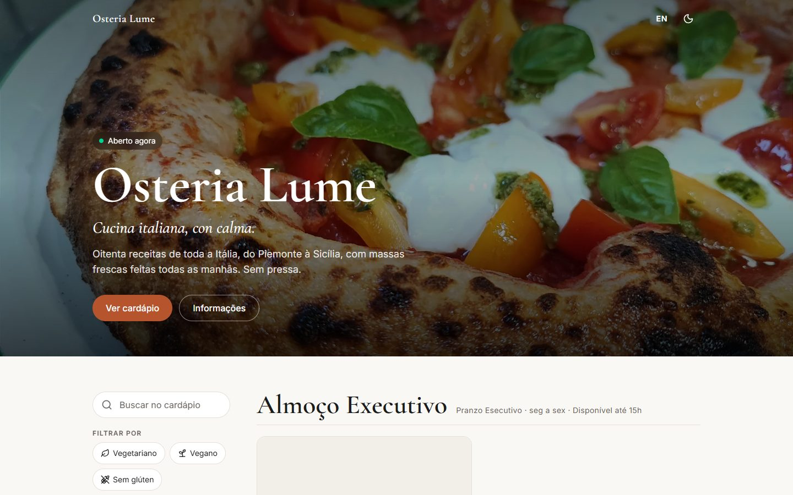

  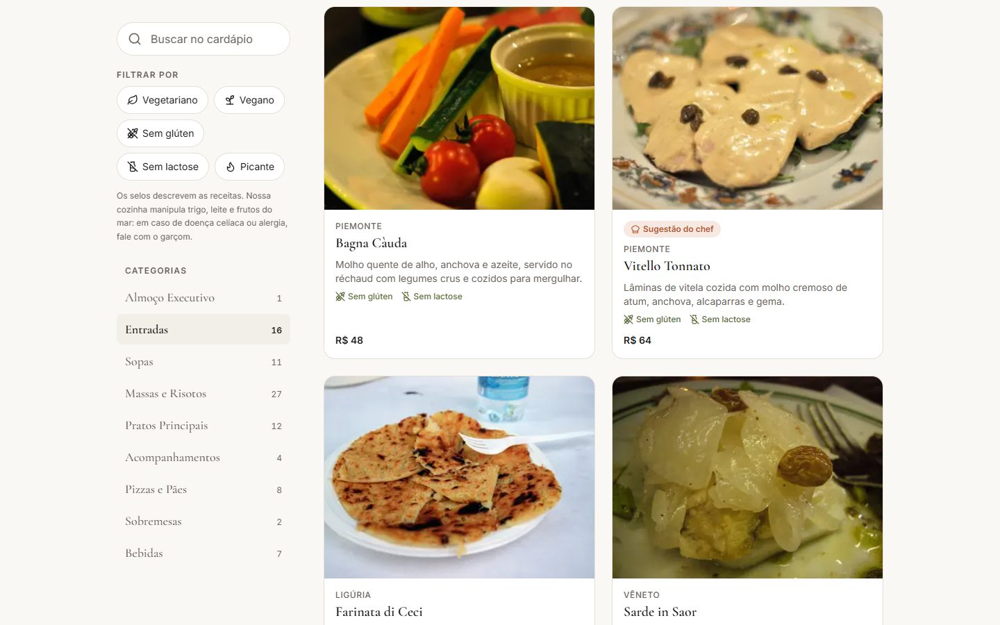
  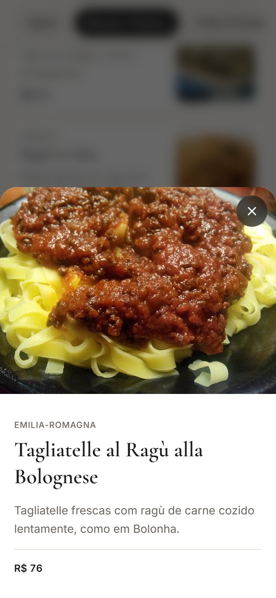
  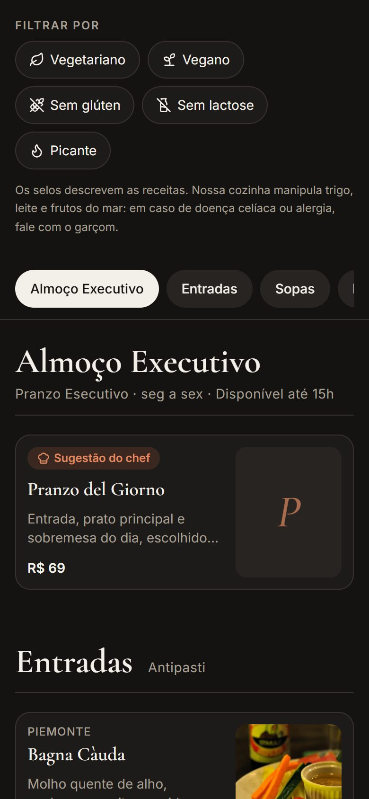

**Destaques**
- 80 pratos regionais italianos com foto, região de origem, preço e selos (vegano, sem glúten, picante…)
- Busca por nome ou ingrediente que ignora acentos, e filtros por selo
- Almoço executivo que só aparece em dias úteis, no horário do almoço (fuso de São Paulo)
- Português e inglês, com o idioma escolhido automaticamente pelo navegador
- Tema claro e escuro, indicador de "Aberto agora" e horário de funcionamento
- Páginas estáticas com imagens otimizadas, rápidas até em conexão móvel

   

### 🩸 Glicolog

  

Diário web de glicemia e insulina para pessoas com diabetes tipo 1, com conta própria, gráficos e importação de planilhas. **Projeto de estudo:** não é um produto em uso e não substitui orientação médica.

<b>🖼️ Ver imagens do Glicolog (3)</b>

 

  
  

  

**Destaques**
- Conta com confirmação por e-mail, recuperação de senha e exclusão de todos os dados
- Registro rápido com a classificação da glicemia aparecendo enquanto o valor é digitado
- Gráficos de 1, 7 ou 30 dias com faixa-alvo personalizável
- Importação de CSV com pré-visualização e sem duplicar registros
- **Acessibilidade:** zero violações WCAG 2.2 AA e paleta validada para daltonismo
- **Privacidade (LGPD):** cada conta só vê os próprios dados (Row Level Security)
- **Testes:** ~100 testes unitários e ~85 de ponta a ponta em 3 tamanhos de tela

     

---

## 🏢 Projetos reais

> [!TIP]
> **Sites feitos para clientes e negócios de verdade.** Ainda não há nenhum publicado aqui. Os próximos tipos de site que quero fazer:

| Tipo | Para quem |
|---|---|
| 💈 Site institucional | Barbearias |
| 🏋️ Site institucional | Academias |
| 💪 Portfólio profissional | Personal trainers |
| 💄 Site institucional | Estética e beleza |
| 🚀 Landing page | Negócios locais em geral |

**Quer que o seu negócio seja o primeiro desta lista?**

---

[← Voltar ao portfólio](README.md)


### 🃏 Vino Cards

  

Vitrine online para um vendedor de cartas de Pokémon TCG e Riftbound, produtos selados e acessórios. O vendedor cadastra o estoque em um painel protegido por senha, e os clientes navegam, filtram e consultam preço, estado e disponibilidade.

> Projeto em andamento: funcionalidades podem mudar, e ainda não há testes automatizados nem pagamento online.

  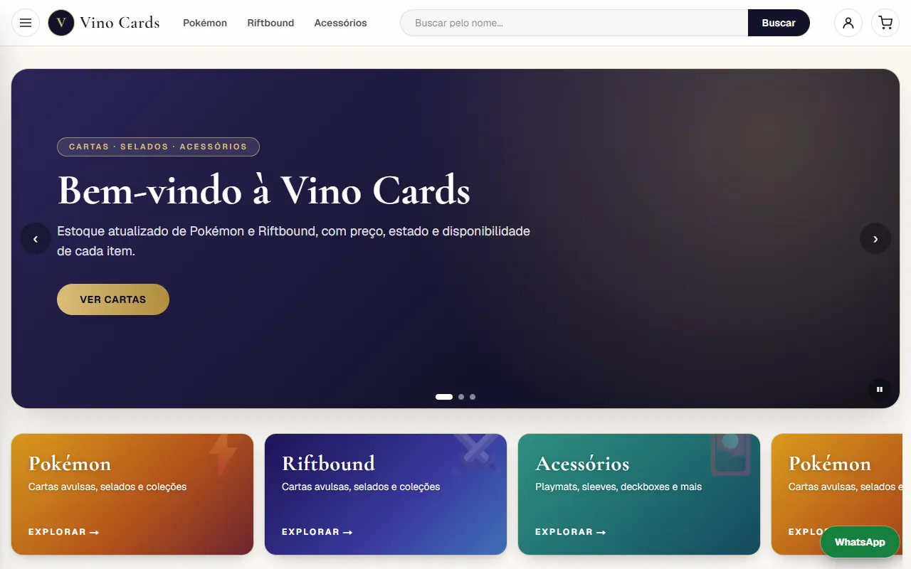
  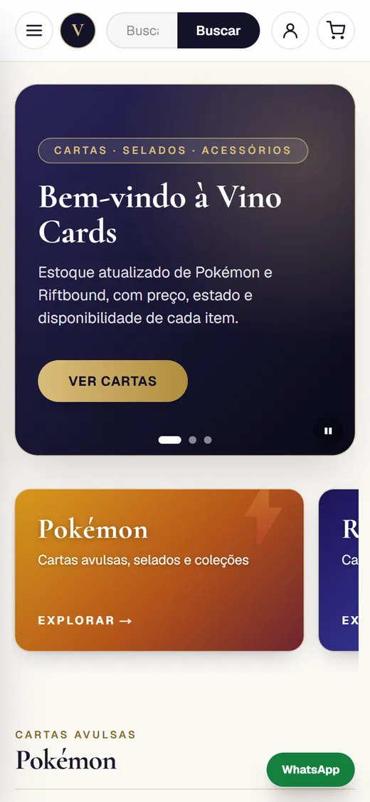

**Destaques**
- Menu por jogo, com selados, cartas avulsas, coleções e acessórios
- Filtros por coleção, raridade, estado, idioma e faixa de preço, com ordenação e paginação
- Status de cada item (disponível, reservado ou vendido) e carrinho salvo no navegador
- QR code do site para baixar e imprimir
- Painel do vendedor: cadastro e edição, busca de cartas na Pokémon TCG API, upload de fotos com compressão e exportação em CSV

**Detalhes técnicos**
- Login do vendedor com Supabase Auth; leitura pública e escrita só autenticada (Row Level Security)
- Integração com a Pokémon TCG API para preencher nome, coleção, raridade e imagem
- Layout responsivo, com filtros recolhíveis no celular

     

### 🛍️ NORTE

  

Loja virtual completa de moda: vitrine, catálogo com filtros, página de produto com variações de cor e tamanho, carrinho, checkout, área do cliente e painel administrativo. Os dados ficam em um banco SQLite local, acessado só pelo servidor.

> Marca, produtos e preços são fictícios. Nenhum pagamento é processado: o pedido aguarda confirmação manual.

  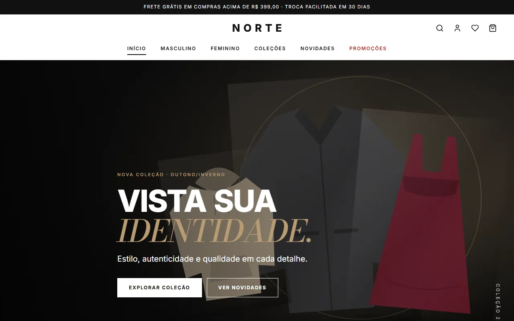
  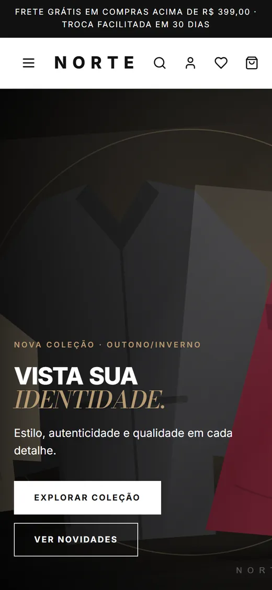

**Destaques**
- Catálogo com filtros e variações (cor × tamanho), cada uma com estoque próprio
- Carrinho que mescla o do visitante ao salvo na conta ao entrar
- Checkout, cupons de desconto, favoritos e área do cliente
- Painel: dashboard, produtos, pedidos, estoque, clientes, categorias, cupons e configurações

**Detalhes técnicos**
- Checkout transacional: o servidor recalcula preços, valida estoque, cupom e frete e grava tudo numa única transação
- Valores monetários em centavos (inteiros); cancelar um pedido devolve estoque e cupom
- Senhas com bcrypt, JWT com expiração, validação com Zod, Helmet e rate limiting
- Teste ponta a ponta da API em banco temporário

        

### 🍽️ Sabor & Arte

  

Site institucional, cardápio interativo, carrinho, checkout e painel administrativo para um restaurante, com back-end próprio e banco de dados. O pedido pode ser enviado pelo WhatsApp já com itens, endereço e total.

> Nome, pratos, preços, endereço e depoimentos são fictícios. Fotos do Unsplash.

  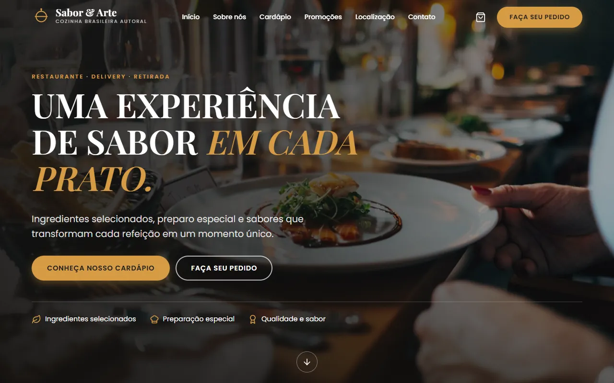
  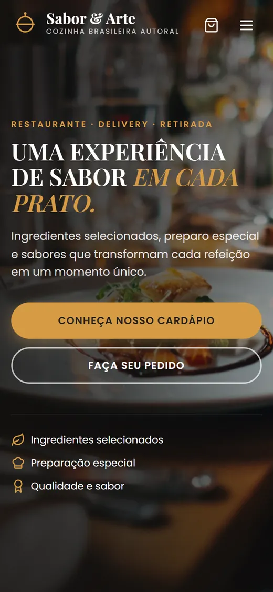

**Destaques**
- Cardápio com categorias, busca, ordenação, promoções e modal com adicionais e observações
- Carrinho salvo no navegador e checkout com entrega, retirada ou consumo no local
- Acompanhamento do pedido com atualização automática
- Painel: pedidos, produtos, categorias, mensagens, avaliações e configurações

**Detalhes técnicos**
- Preços nunca vêm do navegador: o servidor recalcula itens, adicionais, taxas e total
- Autenticação com JWT, senhas com bcrypt e validação de entradas com Zod
- Helmet, rate limit, sanitização contra injeção NoSQL e upload restrito a imagens
- Banco MongoDB embutido, sem instalar nada

        

### 🏋️ FORJA Academia

  

Site institucional e landing page para uma academia fictícia: estrutura, modalidades, planos, equipe, depoimentos, galeria e formulário de contato com validação no navegador e no servidor.

> Preços, depoimentos, equipe, estatísticas e contatos são fictícios e sinalizados no site. Fotos do Unsplash.

  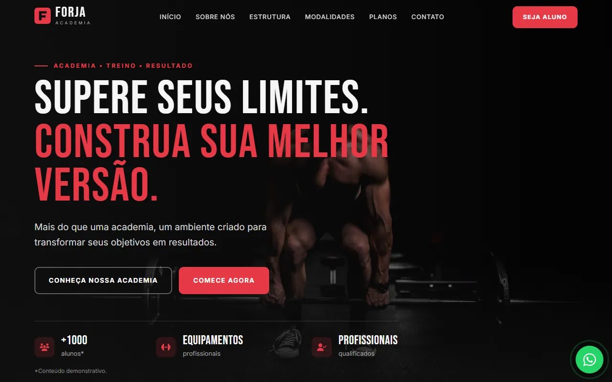
  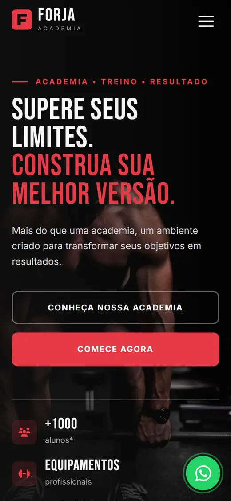

**Destaques**
- Contadores animados, cards com hover e carrossel de depoimentos
- Galeria com lightbox e navegação por teclado
- Formulário com máscara, validação e estados de carregamento, sucesso e erro
- Botão flutuante de WhatsApp

**Detalhes técnicos**
- API de contato com validação, rate limit e sanitização, protegida com Helmet (CSP)
- SEO básico com JSON-LD, skip link, foco visível, ARIA e prefers-reduced-motion
- Conteúdo editável em um único arquivo de dados

      

### 💈 Black Crown Barbershop

  

Site premium em preto e dourado para uma barbearia fictícia. Reúne serviços e preços, clube de planos mensais, equipe, galeria, depoimentos e um agendamento online que grava os pedidos e impede horário duplicado para o mesmo barbeiro.

> Nomes, preços e contatos são fictícios. Imagens do Unsplash.

  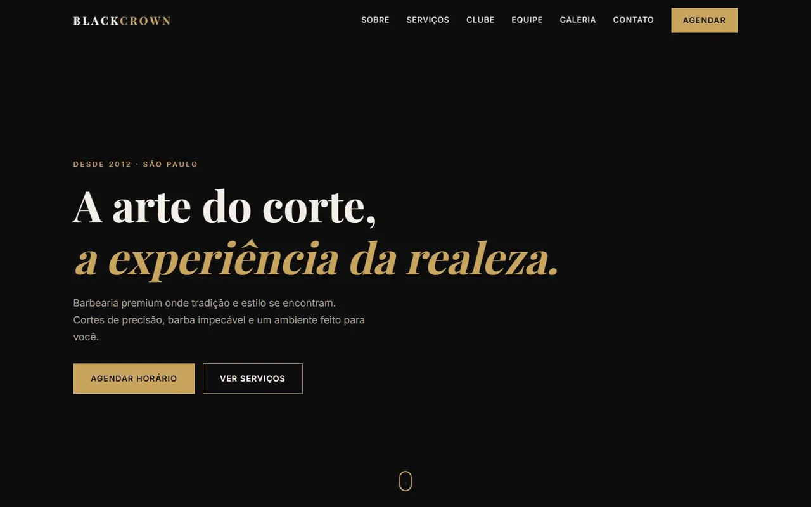
  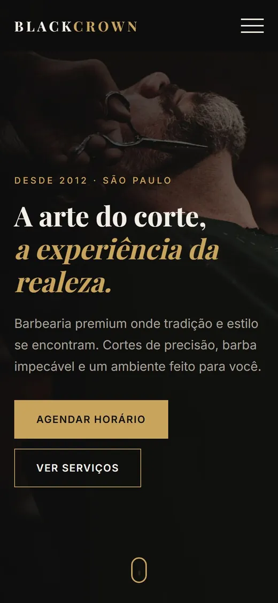

**Destaques**
- Contadores animados, carrossel de depoimentos e galeria com lightbox
- Planos mensais (Clube) e equipe
- Agendamento com bloqueio de horário duplicado
- Menu hambúrguer no celular e suporte a prefers-reduced-motion

**Detalhes técnicos**
- Validação no navegador e no servidor
- API de agendamentos com respostas 201, 400 e 409 (horário ocupado)
- Front-end em HTML, CSS e JavaScript puros, sem frameworks

    

### 💎 Maison Áurea

  

Loja virtual de alta joalheria em preto e dourado, com tipografia serifada, catálogo filtrável por categoria e sacola lateral. O pedido é finalizado pelo WhatsApp com itens e total já montados.

> Marca, produtos, preços e contatos são fictícios.

  
  

**Destaques**
- Catálogo com filtro por categoria e selos de destaque
- Sacola lateral com quantidades e total, salva no navegador
- Finalização do pedido pelo WhatsApp
- Layout responsivo e respeito a prefers-reduced-motion

**Detalhes técnicos**
- Sacola persistida no navegador, sem back-end de pedidos
- Mensagem de pedido montada automaticamente para o WhatsApp

    

