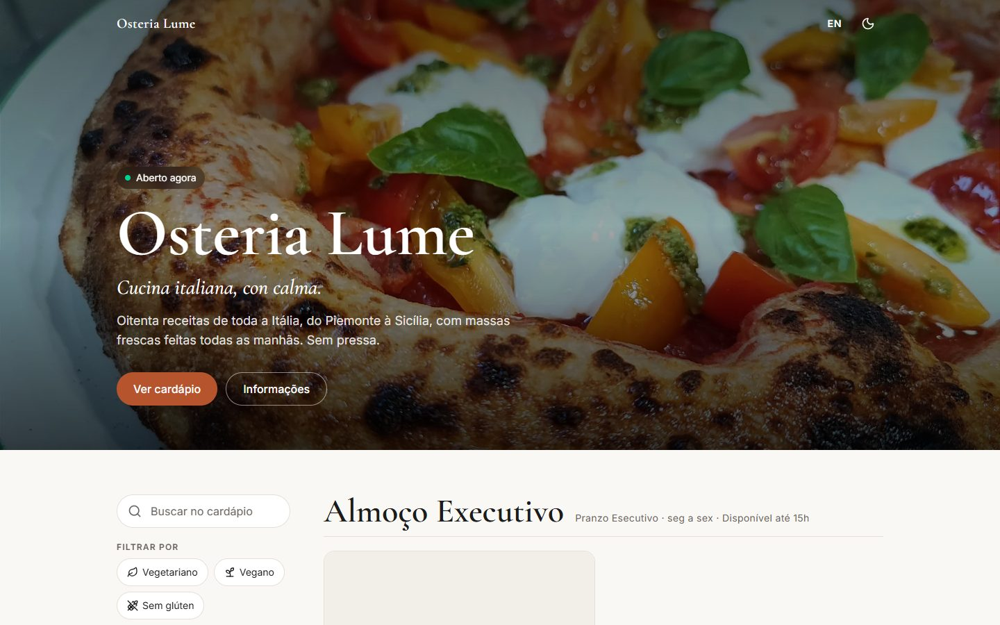
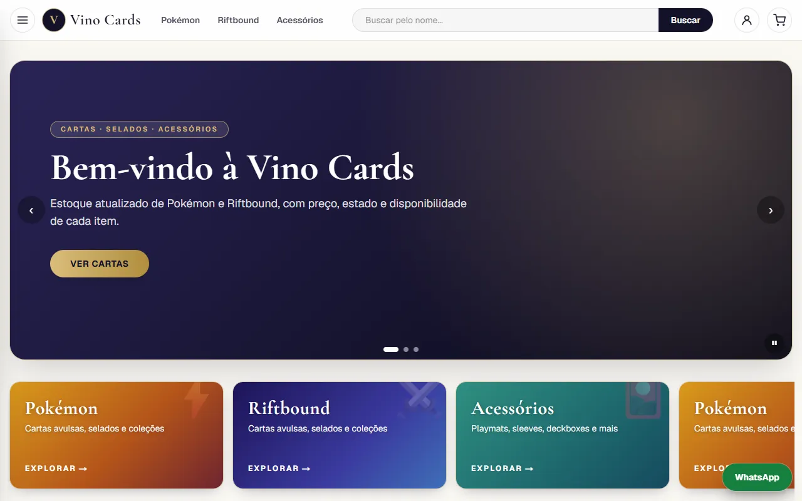
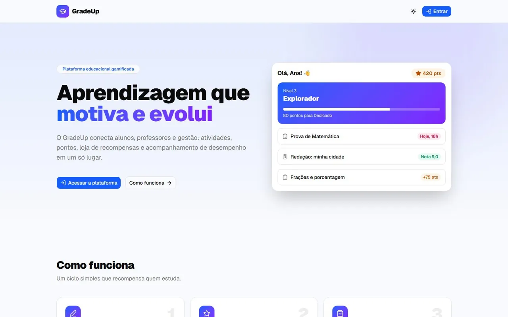
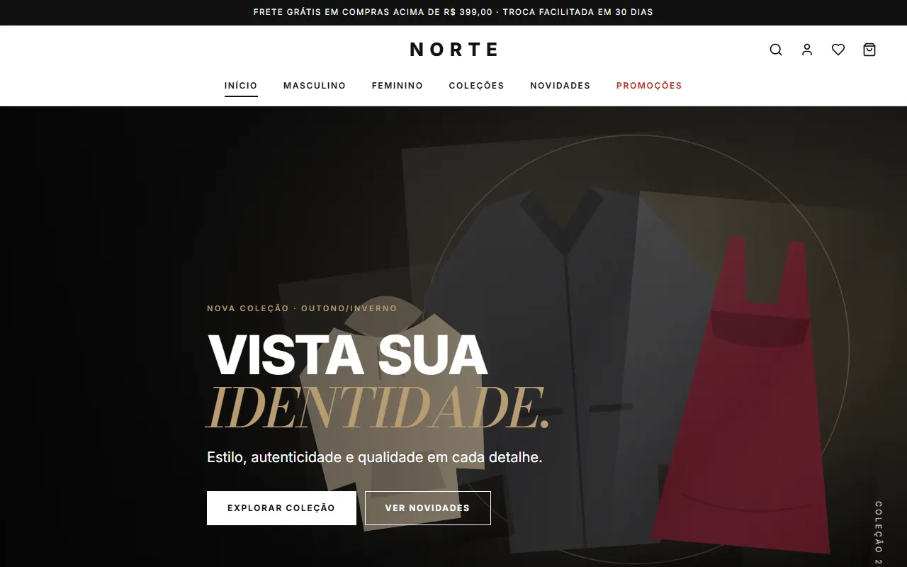
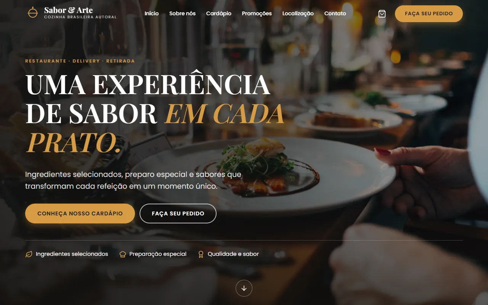
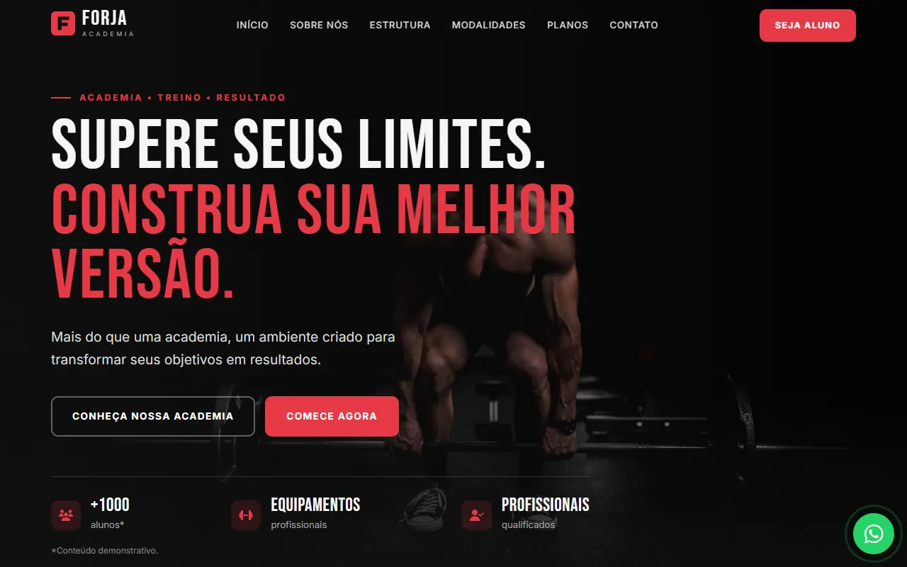
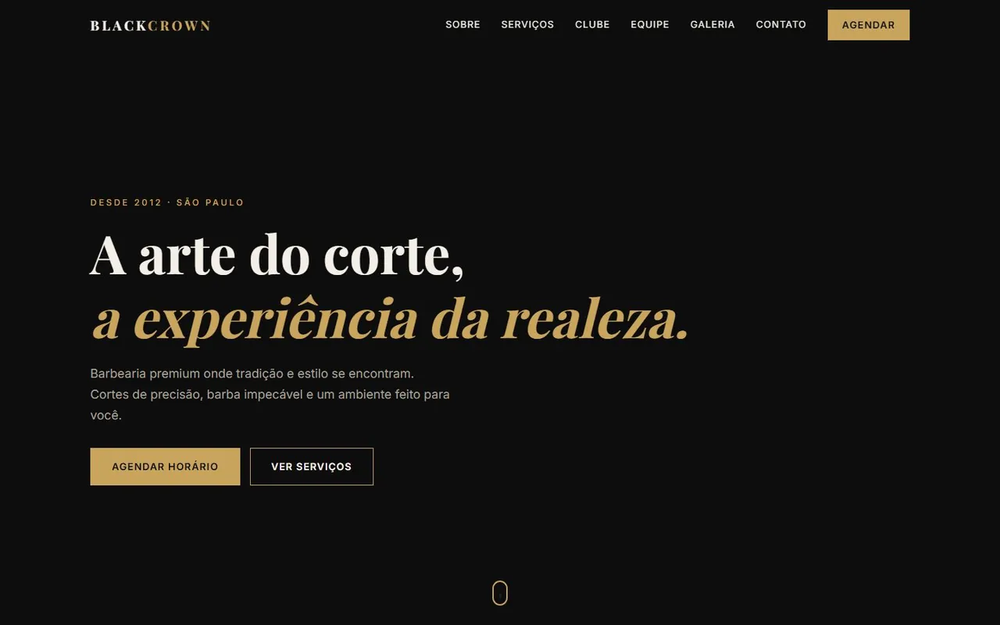
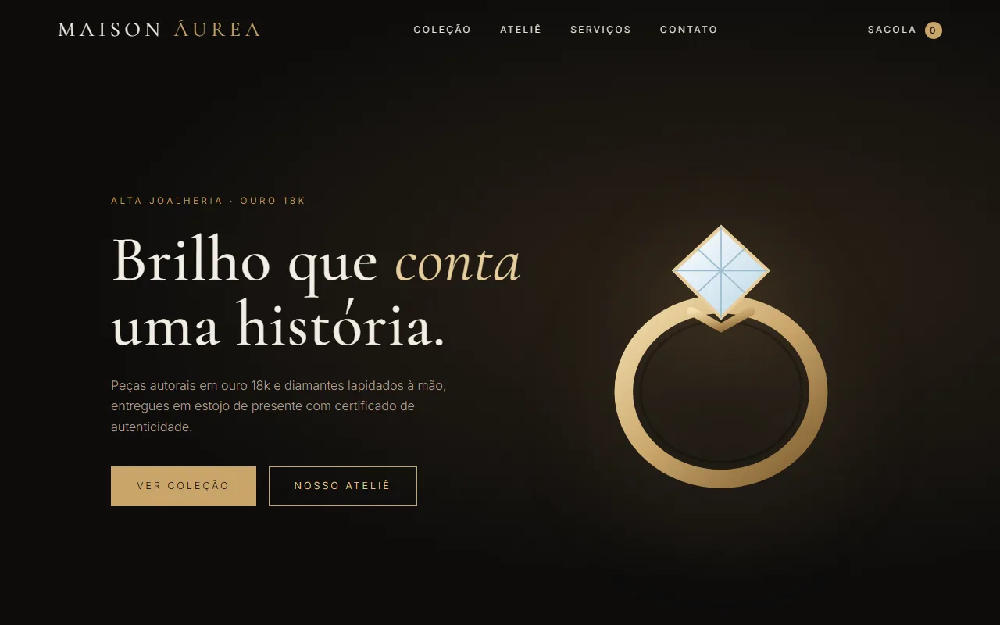

**Crio sites e aplicações web modernos, rápidos e responsivos, pensados primeiro para o celular.**

   

[Sobre](#-sobre-mim) · [Serviços](#-serviços) · [Projetos](#-projetos) · [Como trabalho](#-como-trabalho) · [Tecnologias](#-tecnologias) · [Atividade](#-atividade-no-github) · [Contato](#-contato)

---

## 👋 Sobre mim

Sou desenvolvedor front-end e transformo ideias em sites e sistemas web que funcionam de verdade: **carregam rápido, se adaptam a qualquer tela, são acessíveis e fáceis de usar.**

Trabalho principalmente com **Next.js, React e TypeScript**, e uso **Supabase** quando o projeto precisa de banco de dados, login e armazenamento de arquivos.

- 🎯 **Foco:** sites para negócios locais e sistemas web sob medida
- 📱 **Prioridade:** experiência no celular, onde está a maioria dos clientes
- ♿ **Cuidado:** acessibilidade, desempenho e código testado
- 🌱 **Agora:** aprofundando em testes automatizados e banco de dados

---

## 💼 Serviços

<table>
  <tr>
    <td width="50%" valign="top">
      <h3>🌐 Sites institucionais</h3>
      Para barbearias, academias, personal trainers, estética e beleza. Serviços, preços, fotos, localização e botão de WhatsApp.
    </td>
    <td width="50%" valign="top">
      <h3>🚀 Landing pages</h3>
      Uma página direta ao ponto, feita para transformar visitantes em clientes, com chamada clara para contato.
    </td>
  </tr>
  <tr>
    <td width="50%" valign="top">
      <h3>🍽️ Cardápios digitais</h3>
      Cardápio acessado por QR Code, com fotos, busca, filtros e versão em outros idiomas.
    </td>
    <td width="50%" valign="top">
      <h3>⚙️ Sistemas web</h3>
      Aplicações sob medida com login, banco de dados, gráficos e área administrativa.
    </td>
  </tr>
</table>

---

## 📂 Projetos

### 🧪 Projetos fictícios

> [!NOTE]
> Criados por mim para estudo e para demonstrar o meu trabalho. Não são de clientes, e os negócios e dados mostrados não existem.

<table>
  <tr>
<td width="33%" align="center" valign="top"> <b>🍝 Osteria Lume</b> Cardápio digital de restaurante italiano</td>
<td width="33%" align="center" valign="top"> <b>🩸 Glicolog</b> Diário de glicemia e insulina para diabetes tipo 1</td>
<td width="33%" align="center" valign="top"> <b>🃏 Vino Cards</b> Vitrine de cartas Pokémon TCG e Riftbound</td>
  </tr>
  <tr>
<td width="33%" align="center" valign="top"> <b>🎓 GradeUp</b> Plataforma educacional gamificada</td>
<td width="33%" align="center" valign="top"> <b>🛍️ NORTE</b> E-commerce de moda com painel administrativo</td>
<td width="33%" align="center" valign="top"> <b>🍽️ Sabor & Arte</b> Restaurante com cardápio digital e pedidos online</td>
  </tr>
  <tr>
<td width="33%" align="center" valign="top"> <b>🏋️ FORJA Academia</b> Site institucional de alta conversão para academia</td>
<td width="33%" align="center" valign="top"> <b>💈 Black Crown Barbershop</b> Barbearia premium com agendamento online</td>
<td width="33%" align="center" valign="top"> <b>💎 Maison Áurea</b> Loja virtual premium de joias</td>
  </tr>
</table>

| Projeto | Tipo | Status | Links |
|---|---|:---:|---|
| 🍝 **Osteria Lume** | Cardápio digital de restaurante italiano | 🟢 Demonstração no ar | [Ver online](https://osteria-lume.vercel.app) · [Código](https://github.com/AkiraLeco/osteria-lume) |
| 🩸 **Glicolog** | Diário de glicemia e insulina para diabetes tipo 1 | ✅ Concluído | [Código](https://github.com/AkiraLeco/glicolog) |
| 🃏 **Vino Cards** | Vitrine de cartas Pokémon TCG e Riftbound | 🚧 Em desenvolvimento | [Ver online](https://vino-cards.vercel.app) · [Código](https://github.com/AkiraLeco/vino-cards) |
| 🎓 **GradeUp** | Plataforma educacional gamificada | 🎓 Acadêmico | Privado |
| 🛍️ **NORTE** | E-commerce de moda com painel administrativo | ✅ Concluído | [Código](https://github.com/AkiraLeco/norte-ecommerce) |
| 🍽️ **Sabor & Arte** | Restaurante com cardápio digital e pedidos online | ✅ Concluído | [Código](https://github.com/AkiraLeco/sabor-e-arte) |
| 🏋️ **FORJA Academia** | Site institucional de alta conversão para academia | ✅ Concluído | [Código](https://github.com/AkiraLeco/forja-academia) |
| 💈 **Black Crown Barbershop** | Barbearia premium com agendamento online | ✅ Concluído | [Código](https://github.com/AkiraLeco/barbearia-black-crown) |
| 💎 **Maison Áurea** | Loja virtual premium de joias | ✅ Concluído | [Código](https://github.com/AkiraLeco/maison-aurea) |

### 🏢 Projetos reais

Sites feitos para clientes de verdade. **Ainda não há nenhum publicado. Quer que o seu negócio seja o primeiro?** [Fale comigo](https://wa.me/5511995151617).

---

## 🧭 Como trabalho

| Etapa | O que acontece |
|:---:|---|
| **1. Conversa** | Entendo o seu negócio, o seu público e o que o site precisa resolver. |
| **2. Planejamento** | Defino as páginas, o conteúdo e o visual antes de escrever código. |
| **3. Desenvolvimento** | Construo o site responsivo, com foco em velocidade e facilidade de uso. |
| **4. Revisão** | Você testa, pede ajustes e aprova cada parte. |
| **5. Publicação** | Coloco o site no ar e explico como ele funciona. |

---

## 🧰 Tecnologias

<table>
  <tr>
    <td><b>Front-end</b></td>
    <td>
      
      
      
      
      
      
      
      
    </td>
  </tr>
  <tr>
    <td><b>Back-end e dados</b></td>
    <td>
      
      
      
      
      
      
      
    </td>
  </tr>
  <tr>
    <td><b>Testes</b></td>
    <td>
      
      
    </td>
  </tr>
  <tr>
    <td><b>Ferramentas</b></td>
    <td>
      
      
      
      
    </td>
  </tr>
</table>

---

## 📈 Atividade no GitHub

---

## 📲 Contato

**Quer um site para o seu negócio ou tem uma ideia de projeto? Vamos conversar!**

